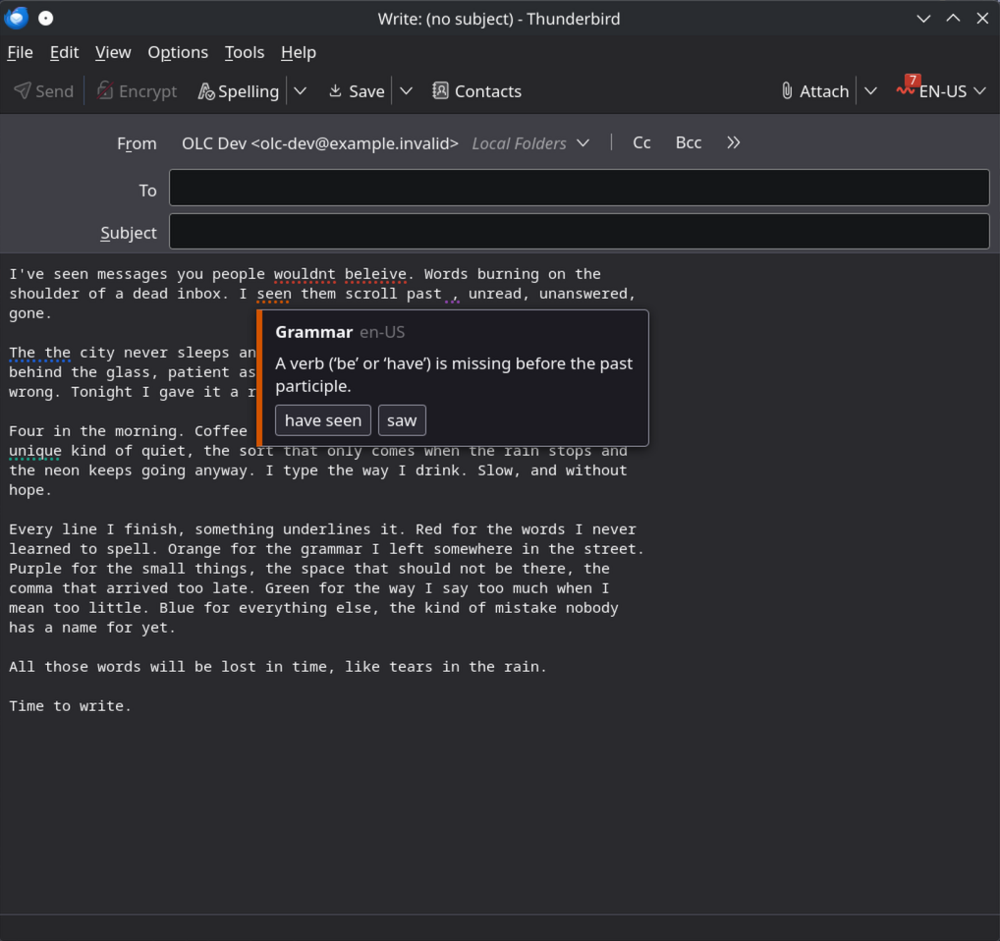
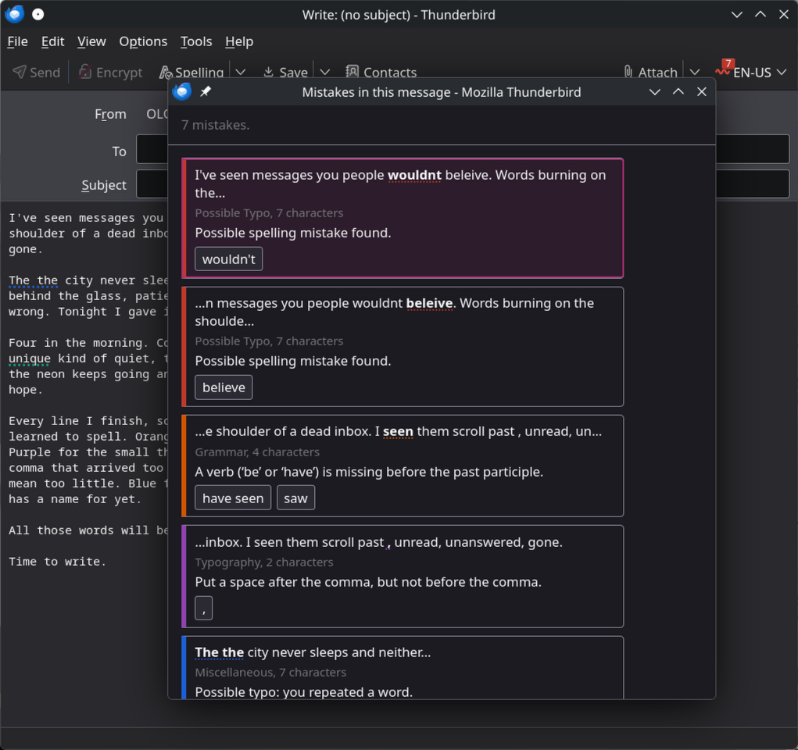
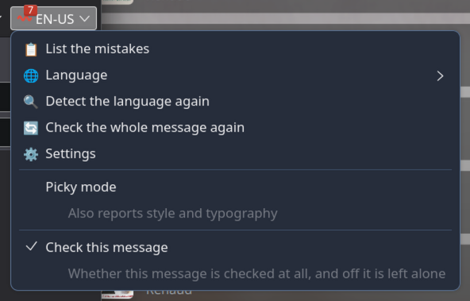
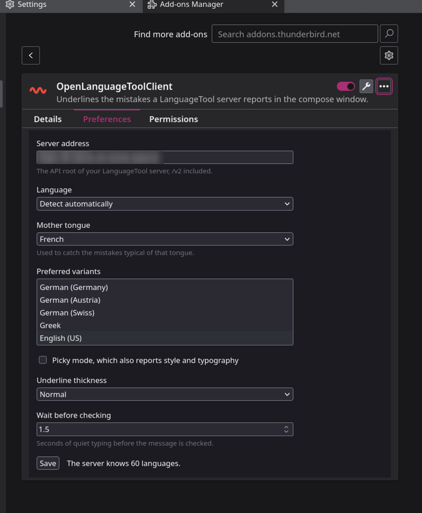

# OpenLanguageToolClient

*English version: [README.md](README.md)*

Client LanguageTool libre pour Thunderbird, conçu pour lui et personne d'autre.

|||
|-|-|
|||
|||

## Installer

[Depuis addons.thunderbird.net](https://addons.thunderbird.net/thunderbird/addon/openlanguagetoolclient/), le site que le gestionnaire de modules de Thunderbird interroge.

Il a besoin d'un serveur LanguageTool et n'en embarque aucun : saisissez son adresse dans les réglages, et choisissez une langue.

## Pourquoi

L'extension officielle `languagetool-mailextension@languagetool.org` est en réalité l'extension navigateur universelle de LanguageTool, avec une poignée de lignes pour Thunderbird greffées dessus. Elle embarque environ 150 adaptateurs de sites web (Gmail, Slack, Notion, Google Docs, ChatGPT...), une couche de reformulation IA, de la télémétrie, du testing.

- **Elle n'est pas libre.** Chaque chunk du code est estampillé `(C) Copyright LanguageTooler GmbH. All rights reserved.` Aucun fichier de licence, aucun dépôt public, aucune source map.
- **Elle est lente sur les gros messages.** Elle envoie le corps entier au serveur, citations comprises, même pour corriger trois lignes réellement rédigées.
- **Elle est encombrée de dispositifs commerciaux.** Teasers premium, statistiques d'écriture, suivi d'usage, tests A/B.

Ce projet met à disposition un client alternatif libre, sobre et rapide pour l'usage d'un serveur LanguageTool.

## Ce que fait ce projet

Il souligne les erreurs détectées par un serveur LanguageTool dans la fenêtre de composition, propose les corrections dans un panneau ouvert par un clic sur le mot souligné ou dans le menu contextuel, et se tait.

Une fenêtre est disponible pour consulter toutes les erreurs du message, avec un extrait de l'endroit où elles se trouvent, de quel type elles sont, combien de texte une correction toucherait...

Outre le serveur et la langue, les réglages permettent de configurer l'épaisseur du soulignement, et le temps avant une nouvelle vérification.

## Ce qu'il ne fera pas

Reformulation IA, synonymes, statistiques d'écriture, suggestions d'emoji, télémétrie, tests A/B, comptes et abonnements, support des sites web hors Thunderbird.

Rien n'est prévu pour la version payante de LanguageTool, gardez l'extension officielle.

## Licence

GNU General Public License v3.0 ou ultérieure. Voir `LICENSE`.

## Contribuer

[CONTRIBUTING.md](CONTRIBUTING.md) rassemble la philosophie, les conventions, les règles de test et le cycle de contribution. Les assistants IA et les outils agentiques lisent d'abord [AGENTS.md](AGENTS.md), qui fixe les règles qui s'imposent à eux.
