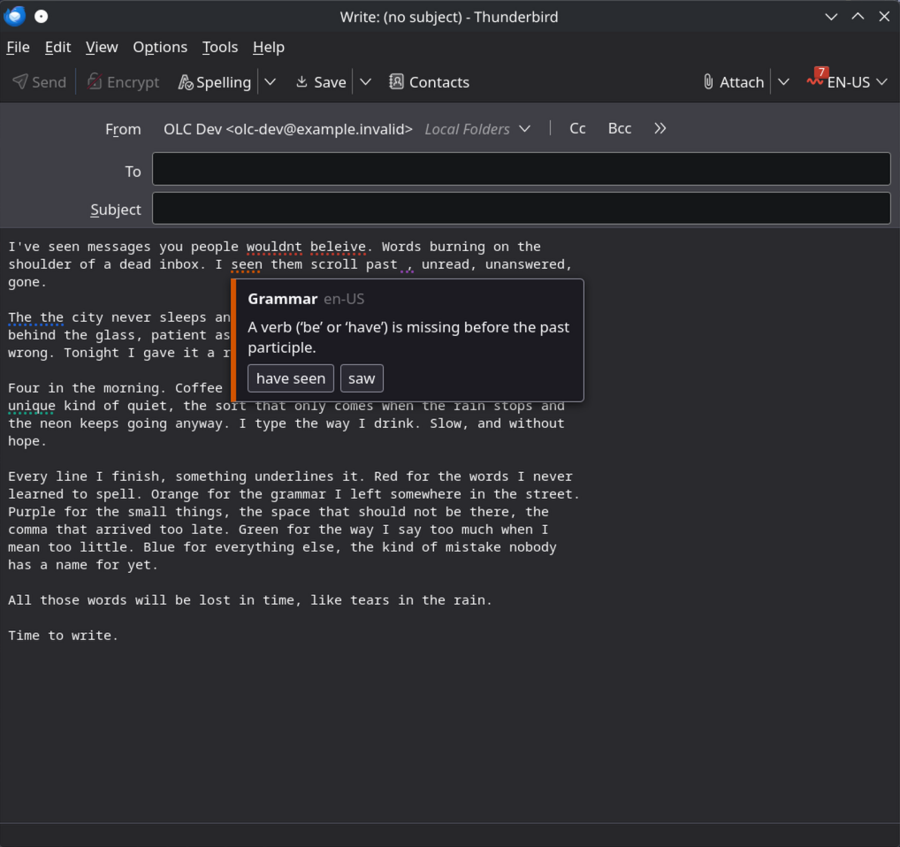
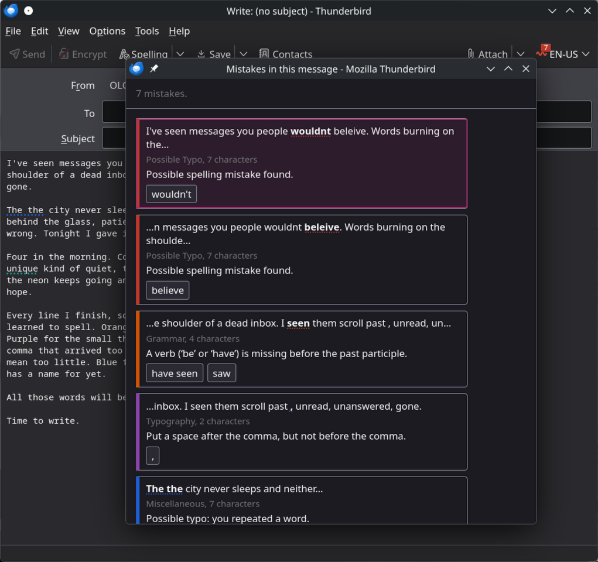
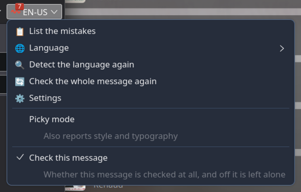
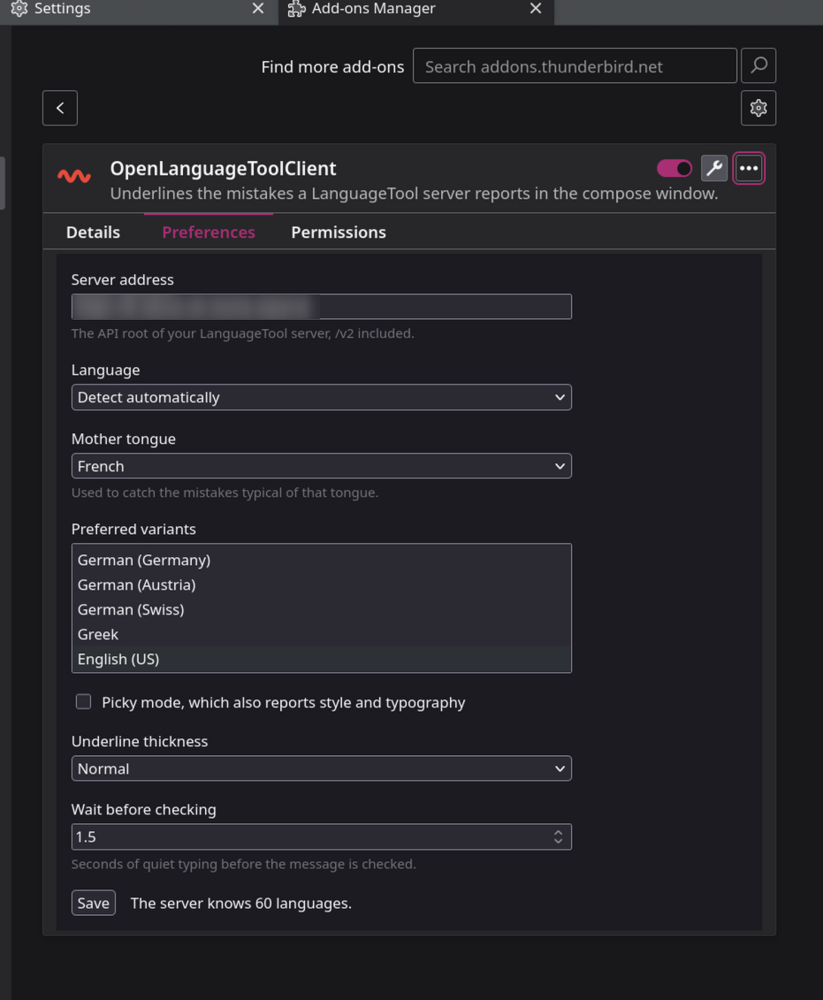

# OpenLanguageToolClient

*Version française : [README.fr.md](README.fr.md)*

A free LanguageTool client for Thunderbird, built for Thunderbird and nothing else.

|||
|-|-|
|||
|||

## Why

The official extension `languagetool-mailextension@languagetool.org` is in fact LanguageTool's universal browser extension, with a handful of Thunderbird lines grafted onto it. It ships about 150 website adapters (Gmail, Slack, Notion, Google Docs, ChatGPT...), an AI rephrasing layer, telemetry and testing.

- **It is not free software.** Every chunk of the code is stamped `(C) Copyright LanguageTooler GmbH. All rights reserved.` No licence file, no public repository, no source map.
- **It is slow on large messages.** It sends the whole body to the server, quotes included, even to correct three lines actually written.
- **It is cluttered with commercial machinery.** Premium teasers, writing statistics, usage tracking, A/B tests.

This project offers an alternative client for a LanguageTool server, free, lean and fast.

## What this project does

It underlines in the compose window the mistakes a LanguageTool server detects, offers the corrections in a panel opened by a click on the underlined word or in the context menu, and keeps quiet.

A window is available to go through every mistake of the message, with an extract of where it sits, what kind it is, how much text a correction would touch...

Besides the server and the language, the settings carry the thickness of the underline and the time before a new check.

## What it will not do

AI rephrasing, synonyms, writing statistics, emoji suggestions, telemetry, A/B tests, accounts and subscriptions, support for websites outside Thunderbird.

Nothing is planned for the paid version of LanguageTool, keep the official extension.

## License

GNU General Public License v3.0 or later. See `LICENSE`.

## Contributing

[CONTRIBUTING.md](CONTRIBUTING.md) holds the philosophy, the conventions, the test rules and the contribution cycle. AI assistants and agentic tools read [AGENTS.md](AGENTS.md) first, which sets the rules that bind them.
